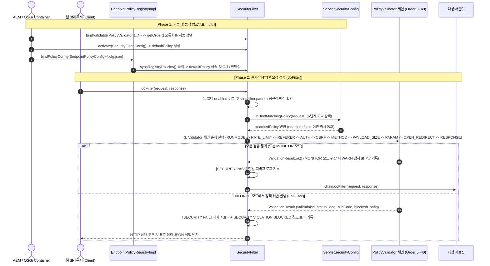

# 🛡️ AEM 6.5 Lightweight Security Filter (`security-simple`)

AEM 6.5 서블릿을 위한 **플러그인 기반 경량 보안 필터(`SecurityFilter`)** 프로젝트입니다.  
**10대 내장 보안 검증기(`PolicyValidator`) 체인**과 번들별 **`.cfg.json` 기반 동적 정책 레지스트리(`EndpointPolicyRegistry`)**, 그리고 **`ServletPolicyRule` 수정 없이 확장 가능한 스키마리스(`extensions`) 플러그인 아키텍처**로 구성되어 있습니다.

---

## 📊 0. 아키텍처 및 기능 기술서 (PPT / 프레젠테이션 문서)

전체 시스템 아키텍처, 6단계 정책 매칭, Validator 플러그인 확장 구조, DSL 문법, 로깅 및 에러 코드 규격을 설명하는 프레젠테이션 문서가 [`docs/`](docs/) 디렉토리에 포함되어 있습니다:

- 📑 **PowerPoint 문서 (`.pptx`)**: [`docs/AEM_Security_Simple_Architecture_Guide.pptx`](docs/AEM_Security_Simple_Architecture_Guide.pptx)
- 🌐 **웹 슬라이드 덱 (`.html`)**: [`docs/AEM_Security_Simple_Presentation.html`](docs/AEM_Security_Simple_Presentation.html)

---

## 📌 1. 전체 10대 내장 `PolicyValidator` 및 실행 순서

`SecurityFilter`는 OSGi 컨테이너에서 `@Component(service = PolicyValidator.class)`로 등록된 모든 검증기를 `@Reference(cardinality = MULTIPLE)`로 동적 바인딩하고, **`PolicyValidator.getOrder()` 오름차순**으로 자동 정렬하여 순차 실행합니다:

| 실행 순서 (`getOrder()`) | Validator 클래스 | 식별자 (`getName()`) | `.cfg.json` 설정 키 (`extensions`) | 주요 검증 내용 | 차단 시 HTTP 상태 및 에러 코드 |
| :---: | :--- | :---: | :--- | :--- | :--- |
| **1 (`5`)** | [`RunModePolicyValidator`](src/main/java/com/example/security/validators/RunModePolicyValidator.java) | `RUNMODE` | `runModes` (또는 `allowedRunModes`), `blockedRunModes` | 현재 AEM 인스턴스 RunMode(`author`, `publish`, `dev`, `stage`, `prod`) 허용/차단 여부 검증 | `403 Forbidden`<br>(`SEC-40305`) |
| **2 (`8`)** | [`RateLimitPolicyValidator`](src/main/java/com/example/security/validators/RateLimitPolicyValidator.java) | `RATE_LIMIT` | `rateLimit`, `rateLimitWindow`, `rateLimitKey` | 슬라이딩 윈도우 기반 IP / IP+타겟 / 사용자별 요청 빈도 제한 (DoS 및 브루트포스 방어) | `429 Too Many Requests`<br>(`SEC-42901`) |
| **3 (`10`)** | [`RefererPolicyValidator`](src/main/java/com/example/security/validators/RefererPolicyValidator.java) | `REFERER` | `allowedReferrers` | 요청 `Referer` 또는 `Origin` 헤더가 기본 허용 도메인(`default.referrers`) 및 서블릿 허용 도메인과 일치하는지 검증 | `403 Forbidden`<br>(`SEC-40303`) |
| **4 (`12`)** | [`AuthPolicyValidator`](src/main/java/com/example/security/validators/AuthPolicyValidator.java) | `AUTH` | `auth` (또는 `authType`), `roles` (또는 `groups`) | 사용자 인증 유형(`ANONYMOUS`, `SA_USER`, `AEM_USER`, `SYSTEM`) 및 AEM JCR 그룹(`roles`) 소속 여부 검증 | `401 Unauthorized` (`SEC-40101`)<br>`403 Forbidden` (`SEC-40301`, `SEC-40302`) |
| **5 (`15`)** | [`CsrfPolicyValidator`](src/main/java/com/example/security/validators/CsrfPolicyValidator.java) | `CSRF` | `csrf` | CSRF 방어 검증 (`NONE`, 표준 `TOKEN`, OAuth 콜백 `OAUTH_STATE`, AEM `GRANITE` 토큰) | `403 Forbidden`<br>(`SEC-40304`, `SEC-40306` ~ `SEC-40310`) |
| **6 (`20`)** | [`MethodPolicyValidator`](src/main/java/com/example/security/validators/MethodPolicyValidator.java) | `METHOD` | `methods` | 요청 HTTP Method(`GET`, `POST`, `PUT`, `DELETE`, `PATCH` 등) 화이트리스트 검증 | `405 Method Not Allowed`<br>(`SEC-40501`) |
| **7 (`25`)** | [`PayloadSizePolicyValidator`](src/main/java/com/example/security/validators/PayloadSizePolicyValidator.java) | `PAYLOAD_SIZE` | `maxPayloadSize` | `POST`/`PUT`/`PATCH` 요청의 `Content-Length`가 허용 크기(`"500KB"`, `"5MB"` 등, 기본 2MB)를 초과하는지 사전 검증 | `413 Payload Too Large`<br>(`SEC-41301`) |
| **8 (`30`)** | [`ParamPolicyValidator`](src/main/java/com/example/security/validators/ParamPolicyValidator.java) | `PARAM` | `params`, `requiredParams`, `allowUndefinedParams` | 필수 파라미터, 미정의 파라미터 차단, Path Traversal(`CWE-22`), 최소/최대 글자 수, 타입 별칭 및 정규식 패턴 검증 | `400 Bad Request`<br>(`SEC-40001` ~ `SEC-40005`, `SEC-40007`) |
| **9 (`35`)** | [`OpenRedirectPolicyValidator`](src/main/java/com/example/security/validators/OpenRedirectPolicyValidator.java) | `OPEN_REDIRECT` | `allowedRedirectDomains`, `allowRelativeRedirect`, `redirectParamNames`, `redirectUrl` | 리다이렉트 파라미터(`redirect`, `returnUrl` 등)의 외부 피싱 도메인 및 위험 스키마(`javascript:` 등) 차단 (`CWE-601`) | `400 Bad Request`<br>(`SEC-40010`) |
| **10 (`40`)** | [`ResponsePolicyValidator`](src/main/java/com/example/security/validators/ResponsePolicyValidator.java) | `RESPONSE` | `responseType`, `defaultResponseType`, `callbackParam` | 클라이언트 `Accept` 헤더와 서블릿 응답 타입(`JSON`, `JSONP`, `HTML`) 호환성 및 `JSONP` 콜백 XSS 안전성 검증 | `406 Not Acceptable` (`SEC-40601`)<br>`400 Bad Request` (`SEC-40006`) |
| **확장 (`100`)** | [`AbstractPolicyValidator`](src/main/java/com/example/security/validators/AbstractPolicyValidator.java) 상속 | 사용자 정의 | 사용자 정의 키 | `@Component(service = PolicyValidator.class)` 선언만으로 기존 코드 수정 없이 자동 등록 | 사용자 정의 (`SEC-XXXXX`) |

---

## 🔄 2. 필터 생명주기 및 요청 처리 흐름 (`activate` & `doFilter`)



---

## 🏛️ 3. 핵심 아키텍처 특징 (Validator-Agnostic 설계)

1. **`ServletPolicyRule`의 순수 컨테이너화 ([ServletPolicyRule.java](src/main/java/com/example/security/models/ServletPolicyRule.java))**
   * `ServletPolicyRule`은 특정 Validator에 종속된 필드를 가지지 않고 오직 **`target`, `enabled`, `mode`, `extensions` 4가지 공통 필드**만 보유합니다.
   * `.cfg.json`에 작성된 모든 검증기 설정(`methods`, `allowedReferrers`, `params`, `runModes`, `auth`, `roles`, `csrf`, `rateLimit`, `maxPayloadSize`, `allowedRedirectDomains`, `responseType` 등)은 자동으로 `extensions` 맵에 수집·상속되며, 각 Validator가 자기 책임하에 꺼내어 해석합니다.
2. **전역/서블릿별 실행 모드 (`ENFORCE` vs `MONITOR`) 및 개별 서블릿 `enabled` 제어**
   * **전역 `mode="MONITOR"` (`SecurityFilter.config`)**: 모든 서블릿에서 위반이 발생해도 요청을 차단하지 않고 `SECURITY VIOLATION MONITORED` 경고 로그만 남긴 뒤 통과시킵니다 (운영 초기 정책 영향도 파악용).
   * **개별 서블릿 `"mode": "MONITOR"` (`.cfg.json`)**: 전역 모드가 `ENFORCE`이더라도 해당 서블릿만 로그 전용 모드로 동작합니다.
   * **개별 서블릿 `"enabled": false` (`.cfg.json`)**: 해당 서블릿은 `defaultPolicy`를 포함한 모든 보안 검증을 건너뜁니다(Bypass).

---

## ⚙️ 4. 전역 OSGi 설정 (`config/com.example.security.filters.SecurityFilter.config`)

```ini
enabled=B"true"
# 전역 보안 실행 모드 (ENFORCE: 위반 시 즉시 차단, MONITOR: 위반 시 WARN 로그만 남기고 통과)
mode="ENFORCE"
sling.filter.pattern="(/aemapi/.*|/sysapi/.*)"

# 기본 정책(defaultPolicy) 활성화 여부
# - true: .cfg.json에 정의되지 않은 서블릿도 아래 default.* 규칙으로 기본 검증 수행
# - false: .cfg.json에 등록된 서블릿만(default.* 속성을 상속받아) 검증하고, 미등록 서블릿은 통과
default.enabled=B"true"
default.runModes=[]
default.referrers=["abc.com"]
default.methods=["GET","POST"]
default.allowUndefinedParams=B"false"
default.params=[ \
  "page:optional:digits:5", \
  "size:optional:digits:4", \
  "sort:optional:alnum:30", \
  "order:optional:asc|desc:4", \
  "lang:optional:pattern(^[a-zA-Z]{2}(?:-[a-zA-Z0-9]{2,})?$):10", \
  "keyword:optional:100" \
]
```

---

## 🧩 5. 10대 내장 Validator별 상세 적용 예제 및 다양한 케이스 (`.cfg.json` & 샘플 코드)

모든 서블릿 보안 정책은 `config/com.example.security.registry.EndpointPolicyConfig~<번들명>.cfg.json` 파일의 `policies` 배열에서 선언적으로 관리합니다.

---

### 5-1. `RunModePolicyValidator` (`order = 5`, 에러 코드: `403 SEC-40305`)

현재 AEM 인스턴스의 RunMode(`author`, `publish`, `dev`, `stage`, `prod` 등)를 확인하여 특정 환경에서만 서블릿 실행을 허용하거나 차단합니다.
* **`runModes`** (또는 `allowedRunModes`): 지정된 RunMode 중 **최소 1개 이상**이 현재 인스턴스 RunMode와 일치해야 통과합니다.
* **`blockedRunModes`**: 지정된 RunMode 중 **하나라도** 현재 인스턴스 RunMode에 포함되면(`runModes` 일치 여부와 무관하게) 최우선으로 차단합니다.

#### ✅ 다양한 적용 케이스 (`.cfg.json`)
```json
{
  "enabled": true,
  "bundle.id": "core-ops",
  "policies": [
    {
      "target": "/aemapi/admin/reindex",
      "runModes": ["author", "dev"],
      "blockedRunModes": ["publish", "prod"],
      "methods": ["POST"]
    },
    {
      "target": "/aemapi/debug/env-dump",
      "runModes": ["dev"],
      "methods": ["GET"]
    },
    {
      "target": "/aemapi/event/live-draw",
      "runModes": ["publish"],
      "methods": ["POST"]
    }
  ]
}
```
* **케이스 1 (`/aemapi/admin/reindex`)**: 로컬/개발 `author`에서는 허용되지만, 운영(`prod`) Author나 모든 `publish` 인스턴스에서는 `403 SEC-40305`로 즉시 차단됩니다.
* **케이스 2 (`/aemapi/debug/env-dump`)**: 오직 `dev` RunMode에서만 호출 가능합니다.
* **케이스 3 (`/aemapi/event/live-draw`)**: 대고객 `publish` 인스턴스에서만 호출 가능합니다.

---

### 5-2. `RateLimitPolicyValidator` (`order = 8`, 에러 코드: `429 SEC-42901`)

슬라이딩 윈도우(Sliding Window) 알고리즘으로 단시간 내 과도한 요청(DoS, OTP 폭탄, 브루트포스 공격)을 차단합니다.
* **`rateLimit`**: 윈도우 시간 내 최대 허용 요청 횟수 (미설정 또는 `0` 이하 시 비활성화)
* **`rateLimitWindow`**: 측정 윈도우 시간(초 단위, 생략 시 기본값 `60`초)
* **`rateLimitKey`**: 카운팅 버킷 구분 기준 (생략 시 기본값 `"IP"`)
  * `"IP"`: 클라이언트 IP 주소 단위로 카운팅
  * `"IP_TARGET"`: `클라이언트 IP + 서블릿 타겟 경로` 조합 단위로 카운팅 (가장 많이 사용)
  * `"USER"`: 로그인된 사용자 ID(`request.getRemoteUser()`) + 타겟 경로 단위로 카운팅 (비로그인 시 IP+타겟으로 자동 폴백)

#### ✅ 다양한 적용 케이스 (`.cfg.json`)
```json
{
  "enabled": true,
  "bundle.id": "core-security",
  "policies": [
    {
      "target": "/aemapi/auth/send-otp",
      "methods": ["POST"],
      "rateLimit": 3,
      "rateLimitWindow": 60,
      "rateLimitKey": "IP_TARGET",
      "params": [
        "mobile:required:phone"
      ]
    },
    {
      "target": "/aemapi/member/point-transfer",
      "methods": ["POST"],
      "rateLimit": 10,
      "rateLimitWindow": 60,
      "rateLimitKey": "USER"
    },
    {
      "target": "/aemapi/search/heavy-catalog",
      "methods": ["GET"],
      "rateLimit": 30,
      "rateLimitWindow": 10,
      "rateLimitKey": "IP"
    }
  ]
}
```
* **케이스 1 (SMS OTP 발송 제한)**: 동일 IP에서 `/aemapi/auth/send-otp`를 60초 동안 최대 3회까지만 호출 가능하며, 4번째 요청부터는 `429 Too Many Requests` (`SEC-42901`, `"Retry after N seconds"`)를 반환합니다.
* **케이스 2 (로그인 사용자별 호출 제한)**: 공인 IP(사내망/공유기)를 여러 명이 공유하더라도 로그인한 계정(`USER`)별로 분당 10회씩 독립적으로 제한합니다.

---

### 5-3. `RefererPolicyValidator` (`order = 10`, 에러 코드: `403 SEC-40303`)

요청의 `Referer` 헤더(없을 경우 `Origin` 헤더 대체 사용)에서 호스트명을 추출해 신뢰할 수 있는 도메인에서 발생한 요청인지 검증합니다.
* **`allowedReferrers`**: 허용할 도메인 배열. `SecurityFilter.config`의 `default.referrers`(예: `["abc.com"]`)와 **자동 합집합(Merge)** 으로 병합됩니다.
* 도메인 매칭은 서브도메인을 자동 지원합니다 (예: `"abc.com"` 또는 `"*.abc.com"` 설정 시 `abc.com`, `www.abc.com`, `shop.abc.com` 모두 허용하되 `evil-abc.com`은 차단).

#### ✅ 다양한 적용 케이스 (`.cfg.json`)
```json
{
  "target": "/aemapi/partner/order-webhook",
  "methods": ["POST"],
  "allowedReferrers": [
    "partner.co.kr",
    "*.payment-gateway.com"
  ]
}
```
* 기본 도메인(`abc.com`, `*.abc.com`)에 더해 `partner.co.kr` 및 `pay.payment-gateway.com`에서 유입된 요청까지 허용합니다. `Referer`와 `Origin` 헤더가 모두 없거나 타 도메인이면 `403 SEC-40303`으로 차단됩니다.

---

### 5-4. `AuthPolicyValidator` (`order = 12`, 에러 코드: `401 SEC-40101` / `403 SEC-40301`, `SEC-40302`)

요청 사용자의 **인증 유형(`auth`)** 과 **AEM 사용자 그룹/역할(`roles`)** 을 검증합니다.

#### 지원되는 4가지 `auth` 타입
| `auth` 설정값 | 의미 및 판별 기준 |
| :---: | :--- |
| **`"ANONYMOUS"`** | 비로그인 익명 사용자 (`userId == null` 또는 `"anonymous"`) |
| **`"SA_USER"`** | 일반 대고객 로그인 사용자 (AEM 내부 작성자나 시스템 계정이 아닌 인증된 외부/멤버십 사용자) |
| **`"AEM_USER"`** | AEM 내부 작성자 및 관리자 (`admin`, `/home/users/aem` 또는 `/home/users/mac` 경로 사용자, `administrators`/`authors`/`content-authors`/`contributor` 그룹 소속, 또는 `aem-`/`author-` 접두사 계정) |
| **`"SYSTEM"`** | AEM 시스템 서비스 계정 (`User.isSystemUser() == true`, `/home/users/system` 경로, 또는 `system`/`service-` 접두사 계정) |

#### ✅ 다양한 적용 케이스 (`.cfg.json`)
```json
{
  "enabled": true,
  "bundle.id": "core-auth-examples",
  "policies": [
    {
      "target": "/aemapi/admin/user-audit",
      "auth": "AEM_USER",
      "roles": ["administrators", "security-auditors"],
      "methods": ["GET"]
    },
    {
      "target": "/aemapi/mypage/order-list",
      "auth": "SA_USER",
      "methods": ["GET"]
    },
    {
      "target": "/sysapi/sap/erp-sync",
      "auth": "SYSTEM",
      "methods": ["POST"]
    },
    {
      "target": "/aemapi/content/approve",
      "roles": ["content-approvers", "administrators"],
      "methods": ["POST"]
    }
  ]
}
```
* **케이스 1 (`auth` + `roles` 동시 검증)**:
  * 비로그인 사용자가 요청 시 → `401 Unauthorized` (`SEC-40101`)
  * 일반 고객(`SA_USER`)이 요청 시 → `403 Forbidden` (`SEC-40301`, `"Forbidden: Access denied for auth type: SA_USER"`)
  * `AEM_USER`이지만 `administrators`나 `security-auditors` 그룹에 속하지 않은 경우 → `403 Forbidden` (`SEC-40302`, `"Forbidden: Insufficient role permissions"`)
* **케이스 2 (`SA_USER` 전용)**: 일반 로그인 고객만 접근 가능하며 비로그인 시 `401 SEC-40101`이 반환됩니다.
* **케이스 3 (`SYSTEM` 계정 전용)**: 내부 시스템 연동 서비스 계정만 호출할 수 있습니다.
* **케이스 4 (`roles`만 단독 지정)**: `auth` 구분 없이 로그인된 사용자가 JCR `UserManager`(또는 `request.isUserInRole()`) 기준 `content-approvers` 또는 `administrators` 그룹에 속해 있으면 통과합니다.

---

### 5-5. `CsrfPolicyValidator` (`order = 15`, 에러 코드: `403 SEC-40304`, `SEC-40306` ~ `SEC-40310`)

상태를 변경하는 요청에 대해 3가지 모드의 CSRF(사이트 간 요청 위조) 토큰 검증을 지원합니다.

| `csrf` 설정값 | 검증 방식 | 요청에서 찾는 토큰 위치 | 서버 대조 기준 및 위반 코드 |
| :---: | :--- | :--- | :--- |
| **`"NONE"`** | CSRF 검증 생략 (기본값) | - | - |
| **`"TOKEN"`** | 표준 일반 CSRF 토큰 검증 (Double Submit Cookie / Synchronizer Token 패턴) | **헤더**: `X-CSRF-Token`, `CSRF-Token`, `X-XSRF-TOKEN`<br>**파라미터**: `_csrf`, `csrf_token`, `csrfToken`, `:cq_csrf_token`, `token` | **세션 속성**(`CSRF_TOKEN`, `csrfToken`, `_csrf`, `X-CSRF-Token`) 또는 **쿠키**(`CSRF-TOKEN`, `XSRF-TOKEN`, `csrf_token`)와 상수 시간(`MessageDigest.isEqual`) 비교<br>• 토큰 누락: `SEC-40304`<br>• 불일치/세션 만료: `SEC-40306` |
| **`"GRANITE"`** | Adobe Granite (`com.adobe.granite.csrf.impl.CSRFTokenService`) 호환 검증 | **헤더**: `CSRF-Token`<br>**파라미터**: `:cq_csrf_token` | OSGi `CSRFTokenService`가 바인딩되어 있으면 서비스로 검증하고, 없으면 토큰 형식(8자 이상, 공백/개행 미포함)을 검증<br>• 토큰 누락: `SEC-40309`<br>• 유효하지 않은 토큰: `SEC-40310` |
| **`"OAUTH_STATE"`** | OAuth 2.0 / OIDC 로그인 콜백의 `state` 파라미터 위변조 검증 | **파라미터**: `state` | **세션 속성**(`OAUTH_STATE`, `oauth_state`, `state`) 또는 **쿠키**(`OAUTH_STATE`, `oauth_state`)와 상수 시간 비교<br>• `state` 파라미터 누락: `SEC-40307`<br>• 세션/쿠키 불일치: `SEC-40308` |

#### ✅ 다양한 적용 케이스 (`.cfg.json`)
```json
{
  "enabled": true,
  "bundle.id": "core-csrf-examples",
  "policies": [
    {
      "target": "/aemapi/member/password-change",
      "methods": ["POST"],
      "csrf": "TOKEN"
    },
    {
      "target": "/aemapi/authoring/page-lock",
      "methods": ["POST"],
      "csrf": "GRANITE"
    },
    {
      "target": "/aemapi/oauth/callback",
      "methods": ["GET", "POST"],
      "csrf": "OAUTH_STATE",
      "params": [
        "code:required:200",
        "state:required:100"
      ]
    }
  ]
}
```

#### 💻 클라이언트 연동 샘플 코드
```javascript
// 1. csrf="TOKEN" 설정 서블릿 호출 예시 (세션 또는 XSRF-TOKEN 쿠키와 일치하는 헤더 전송)
fetch('/aemapi/member/password-change', {
  method: 'POST',
  headers: {
    'Content-Type': 'application/x-www-form-urlencoded',
    'X-CSRF-Token': sessionStorage.getItem('CSRF_TOKEN')
  },
  body: new URLSearchParams({ currentPwd: '...', newPwd: '...' })
});

// 2. csrf="GRANITE" 설정 서블릿 호출 예시 (AEM @granite/csrf 토큰 연동)
const tokenResp = await fetch('/libs/granite/csrf/token.json');
const { token } = await tokenResp.json();
await fetch('/aemapi/authoring/page-lock', {
  method: 'POST',
  headers: { 'CSRF-Token': token }
});
```

---

### 5-6. `MethodPolicyValidator` (`order = 20`, 에러 코드: `405 SEC-40501`)

서블릿별로 허용된 HTTP 메서드(`GET`, `POST`, `PUT`, `DELETE`, `PATCH`, `HEAD`, `OPTIONS`)만 통과시킵니다. `.cfg.json`에 `methods`를 생략하면 `SecurityFilter.config`의 `default.methods`(기본 `["GET", "POST"]`)를 자동 상속받습니다.

```json
{
  "target": "/aemapi/order/cancel",
  "methods": ["POST"]
}
```
* `GET /aemapi/order/cancel` 또는 `DELETE /aemapi/order/cancel` 요청 시 `405 Method Not Allowed` (`SEC-40501`)로 차단됩니다.

---

### 5-7. `PayloadSizePolicyValidator` (`order = 25`, 에러 코드: `413 SEC-41301`)

`POST`, `PUT`, `PATCH` 요청의 본문(Stream)을 서블릿이 읽어 메모리에 적재하기 전에 `Content-Length` 헤더를 검사하여 대용량 페이로드 공격(`CWE-400` / `CWE-770`)을 즉시 차단합니다.
* **`maxPayloadSize`**: 바이트 숫자(`1048576`) 또는 단위 문자열(`"512B"`, `"100KB"`, `"5MB"`, `"1GB"`) 모두 지원합니다. (미설정 시 기본값 **2MB** 적용)

#### ✅ 다양한 적용 케이스 (`.cfg.json`)
```json
{
  "enabled": true,
  "bundle.id": "core-payload",
  "policies": [
    {
      "target": "/aemapi/comment/write",
      "methods": ["POST"],
      "maxPayloadSize": "64KB"
    },
    {
      "target": "/aemapi/voc/attachment-upload",
      "methods": ["POST"],
      "maxPayloadSize": "20MB"
    }
  ]
}
```
* `/aemapi/comment/write`에 64KB(65,536 bytes)를 초과하는 본문이 유입되면 `413 Payload Too Large` (`SEC-41301`)가 반환됩니다.

---

### 5-8. `ParamPolicyValidator` (`order = 30`, 에러 코드: `400 SEC-40001` ~ `SEC-40005`, `SEC-40007`)

요청 파라미터에 대해 **① 필수 파라미터 누락(`SEC-40001`), ② 미정의 파라미터 유입(`SEC-40002`), ③ Path Traversal 공격(`SEC-40007`), ④ 최소 길이 미달(`SEC-40003`), ⑤ 최대 길이 초과(`SEC-40004`), ⑥ 타입/정규식 불일치(`SEC-40005`)** 를 한 번에 검증합니다.

#### Case A. 간편 DSL 문법, JSON 객체 배열, `requiredParams` 조합
```json
{
  "target": "/aemapi/member/register",
  "methods": ["POST"],
  "allowUndefinedParams": false,
  "params": [
    "memberId:required:alnum:4..20",
    "userName:required:korean:2..20",
    "email:required:email:50",
    "mobile:required:phone",
    "birthDate:optional:date",
    "grade:required:VIP|GOLD|SILVER:10",
    "couponCode:optional:pattern(^CPN-[A-Z0-9]{4}-[A-Z0-9]{4}$):15",
    "memo:optional:200",
    "attachmentPath:optional:200:allowPathTraversal"
  ],
  "requiredParams": ["agreeTerms"]
}
```

#### Case B. JSON 객체 배열 방식 (`params` 내 상세 객체 정의)
```json
{
  "target": "/aemapi/account/verify",
  "methods": ["POST"],
  "params": [
    {
      "name": "accountNo",
      "required": true,
      "minLength": 10,
      "maxLength": 14,
      "type": "digits"
    },
    {
      "name": "bankCode",
      "required": true,
      "pattern": "^[0-9]{3}$"
    }
  ]
}
```

#### 내장 타입 별칭(Type Alias) 13종 요약
| 타입 키워드 | 자동 적용되는 정규식 (`pattern`) | 기본 `maxLength` |
| :--- | :--- | :---: |
| `digits` / `number` / `numeric` | `^[0-9]+$` | 제한 없음 |
| `alnum` / `alphanumeric` | `^[a-zA-Z0-9_]+$` | 제한 없음 |
| `alpha` | `^[a-zA-Z]+$` | 제한 없음 |
| `korean` / `hangul` | `^[가-힣a-zA-Z\s]+$` | 제한 없음 |
| `email` | `^[a-zA-Z0-9._%+-]+@[a-zA-Z0-9.-]+\.[a-zA-Z]{2,}$` | `100` |
| `phone` | `^01[016789]-?\d{3,4}-?\d{4}$` | `13` |
| `date` | `^\d{4}-\d{2}-\d{2}$` | `10` |
| `datetime` | `^\d{4}-\d{2}-\d{2}[ T]\d{2}:\d{2}(?::\d{2})?$` | `19` |
| `time` | `^\d{2}:\d{2}(?::\d{2})?$` | `8` |
| `uuid` | `^[0-9a-fA-F]{8}-[0-9a-fA-F]{4}-[0-9a-fA-F]{4}-[0-9a-fA-F]{4}-[0-9a-fA-F]{12}$` | `36` |
| `zipcode` / `postal` | `^\d{5}$` | `5` |
| `ip` / `ipv4` | IPv4 주소 정규식 | `15` |
| `url` | `^https?://[a-zA-Z0-9.-]+(?:\.[a-zA-Z]{2,})+(?:/[^\s<>"]*)?$` | 제한 없음 |

---

### 5-9. `OpenRedirectPolicyValidator` (`order = 35`, 에러 코드: `400 SEC-40010`)

로그인이나 외부 연동 후 리다이렉트 URL을 받는 파라미터에서 악성 피싱 사이트(`https://evil.com`), 프로토콜 상대 경로(`//evil.com`),危险 스키마(`javascript:alert(1)`), UserInfo 우회(`https://abc.com@evil.com`), CRLF 인젝션을 차단합니다 (`CWE-601`).
* **기본 검사 대상 파라미터**: `redirect`, `redirect_to`, `returnurl`, `targeturl`, `url`, `dest`, `continue`, `next`, `goto`
* **`redirectParamNames`**: 기본 9개 파라미터 외에 추가로 검사할 커스텀 파라미터명 목록
* **`allowedRedirectDomains`**: 리다이렉트를 허용할 외부 도메인 화이트리스트 (미지정 시 서블릿 및 기본 정책의 `allowedReferrers` 도메인을 신뢰 도메인으로 사용)
* **`allowRelativeRedirect`**: `/content/abc/ko.html` 같은 내부 상대 경로 허용 여부 (기본값: `true`)

#### ✅ 다양한 적용 케이스 (`.cfg.json`)
```json
{
  "enabled": true,
  "bundle.id": "core-redirect",
  "policies": [
    {
      "target": "/aemapi/auth/sso-login",
      "methods": ["GET", "POST"],
      "allowedRedirectDomains": [
        "*.abc.com",
        "member.partner.com"
      ],
      "allowRelativeRedirect": true,
      "allowUndefinedParams": true
    },
    {
      "target": "/aemapi/external/partner-jump",
      "methods": ["GET"],
      "redirectParamNames": ["jumpToUrl"],
      "allowedRedirectDomains": ["official.partner.com"],
      "allowRelativeRedirect": false,
      "params": [
        "jumpToUrl:required:200"
      ]
    }
  ]
}
```
* **케이스 1 (`/aemapi/auth/sso-login`)**:
  * `?redirect=/content/abc/home.html` (내부 상대 경로) → **통과**
  * `?redirect=https://shop.abc.com/cart` (허용 서브도메인) → **통과**
  * `?redirect=https://evil.com` 또는 `?redirect=//evil.com` 또는 `?redirect=javascript:alert(1)` → **`400 SEC-40010` 차단**
* **케이스 2 (`/aemapi/external/partner-jump`)**: 커스텀 파라미터 `jumpToUrl`까지 검사하며, `"allowRelativeRedirect": false`이므로 오직 `https://official.partner.com/...` 절대 URL만 허용됩니다.

---

### 5-10. `ResponsePolicyValidator` (`order = 40`, 에러 코드: `406 SEC-40601` / `400 SEC-40006`)

서블릿의 응답 형식(`responseType`)과 클라이언트의 `Accept` 헤더가 호환되는지 사전 검증하고, `JSONP` 응답인 경우 콜백 함수명 파라미터를 통한 XSS 스크립트 주입을 방어합니다.
* **`responseType`**: `"JSON"`, `"JSONP"`, `"HTML"`, `"FILE"`, `"REDIRECT"`, `"DEFAULT"` (미설정 시 `"DEFAULT"`로 통과)
* **`callbackParam`**: `responseType="JSONP"`일 때 검사할 콜백 파라미터 이름 (생략 시 기본값 `"callback"`)

#### ✅ 다양한 적용 케이스 (`.cfg.json`)
```json
{
  "enabled": true,
  "bundle.id": "core-response",
  "policies": [
    {
      "target": "/aemapi/catalog/products",
      "methods": ["GET"],
      "responseType": "JSON"
    },
    {
      "target": "/aemapi/legacy/jsonp-ticker",
      "methods": ["GET"],
      "responseType": "JSONP",
      "callbackParam": "cb",
      "allowUndefinedParams": true
    }
  ]
}
```
* **케이스 1 (`responseType="JSON"`)**: 클라이언트가 `Accept: text/html` 헤더로 요청하면 `406 Not Acceptable` (`SEC-40601`)로 차단하고, `Accept: application/json` 또는 `*/*`이면 통과합니다.
* **케이스 2 (`responseType="JSONP"`)**:
  * `?cb=jQuery123_456` → 유효한 JS 식별자(`^[a-zA-Z_$][a-zA-Z0-9_$.]*$`)이므로 **통과**
  * `?cb=` (누락) → `400 SEC-40001` 차단
  * `?cb=<script>alert(1)</script>` → **`400 SEC-40006` (`RESPONSE_TYPE_JSONP_INVALID`) 차단**

---

## 🚀 6. 복합 실전 시나리오 (10대 Validator 종합 `.cfg.json` & 서블릿 샘플)

실제 운영 프로젝트에서 여러 Validator 규칙을 하나의 서블릿 정책에 조합하여 적용하는 종합 예제입니다:

```json
{
  "enabled": true,
  "bundle.id": "core-commerce",
  "policies": [
    {
      "target": "/aemapi/order/checkout",
      "enabled": true,
      "mode": "ENFORCE",
      "runModes": ["publish", "dev", "stage", "prod"],
      "rateLimit": 10,
      "rateLimitWindow": 60,
      "rateLimitKey": "USER",
      "allowedReferrers": ["shop.abc.com", "m.abc.com"],
      "auth": "SA_USER",
      "csrf": "TOKEN",
      "methods": ["POST"],
      "maxPayloadSize": "256KB",
      "allowUndefinedParams": false,
      "params": [
        "orderId:required:alnum:8..20",
        "paymentMethod:required:CARD|BANK|POINT:10",
        "receiverPhone:required:phone",
        "zipCode:required:zipcode",
        "deliveryMemo:optional:100",
        "returnUrl:optional:200"
      ],
      "allowedRedirectDomains": ["*.abc.com"],
      "responseType": "JSON"
    }
  ]
}
```

### 대상 서블릿 자바 코드 샘플 ([UserContactServlet.java](src/main/java/com/example/security/servlets/UserContactServlet.java))
서블릿 클래스에는 보안 검증 코드가 단 한 줄도 필요 없으며, 순수 비즈니스 로직만 작성합니다:

```java
@Component(
        service = { Servlet.class },
        property = {
                "sling.servlet.paths=/aemapi/user/contact",
                "sling.servlet.methods=POST",
                "service.description=User Contact Inquiry Servlet"
        }
)
public class UserContactServlet extends SlingAllMethodsServlet {

    @Override
    protected void doPost(final SlingHttpServletRequest request, final SlingHttpServletResponse response)
            throws ServletException, IOException {
        // SecurityFilter의 10대 Validator 체인을 모두 통과한 안전한 요청만 도달합니다.
        String name = request.getParameter("name");
        String email = request.getParameter("email");

        response.setContentType("application/json;charset=UTF-8");
        response.getWriter().write("{\"status\":\"success\"}");
    }
}
```

---

## 🔌 7. 커스텀 `PolicyValidator` 플러그인 추가 가이드

기존 `SecurityFilter`나 `ServletPolicyRule`을 전혀 수정하지 않고 **클래스 1개만 작성하면 OSGi가 자동으로 검증 체인에 등록**합니다:

```java
package com.example.security.validators;

import com.example.security.models.ServletPolicyRule;
import com.example.security.models.ServletSecurityConfig;
import org.osgi.service.component.annotations.Component;

import javax.servlet.http.HttpServletRequest;

@Component(service = PolicyValidator.class, immediate = true)
public class ApiKeyPolicyValidator extends AbstractPolicyValidator {

    public ApiKeyPolicyValidator() {
        super("API_KEY", 14); // 실행 순서 14: AUTH(12) 다음, CSRF(15) 이전 실행
    }

    @Override
    protected ValidationResult doValidate(HttpServletRequest req, ServletPolicyRule policy, ServletSecurityConfig root) {
        String requiredHeader = policy.getExtensionString("requiredHeader");
        if (requiredHeader != null && req.getHeader(requiredHeader) == null) {
            return blockCustom(policy, 401, "SEC-40102",
                    "requiredHeader=" + requiredHeader,
                    "Missing required API key header: " + requiredHeader,
                    "Unauthorized: Missing header " + requiredHeader);
        }
        return pass();
    }
}
```
이제 `.cfg.json`에 `"requiredHeader": "X-Partner-Key"`만 추가하면 즉시 동작합니다.

---

## 📋 8. 표준 보안 에러 코드 (`SecurityErrorCode`) 및 로그 출력 포맷

### 8-1. 전체 에러 코드 일람 ([SecurityErrorCode.java](src/main/java/com/example/security/models/SecurityErrorCode.java))

| 서브 에러 코드 | HTTP 상태 | 열거형 상수명 | 발생 Validator | 기본 응답 메시지 |
| :---: | :---: | :--- | :---: | :--- |
| `SEC-40001` | `400` | `PARAM_REQUIRED` | `PARAM` / `RESPONSE` | `Bad Request: Missing required parameter: %s` |
| `SEC-40002` | `400` | `PARAM_UNDEFINED` | `PARAM` | `Bad Request: Parameter [%s] is not permitted` |
| `SEC-40003` | `400` | `PARAM_TOO_SHORT` | `PARAM` | `Bad Request: Parameter [%s] is too short (min: %d)` |
| `SEC-40004` | `400` | `PARAM_TOO_LONG` | `PARAM` | `Bad Request: Parameter [%s] exceeds max length of %d` |
| `SEC-40005` | `400` | `PARAM_INVALID_FORMAT` | `PARAM` | `Bad Request: Parameter [%s] has invalid format` |
| `SEC-40006` | `400` | `RESPONSE_TYPE_JSONP_INVALID` | `RESPONSE` | `Bad Request: Invalid JSONP callback parameter: %s` |
| `SEC-40007` | `400` | `PARAM_PATH_TRAVERSAL` | `PARAM` | `Bad Request: Potential Path Traversal attack detected in parameter [%s]` |
| `SEC-40010` | `400` | `OPEN_REDIRECT_FORBIDDEN` | `OPEN_REDIRECT` | `Bad Request: Untrusted or invalid redirect URL: %s` |
| `SEC-40101` | `401` | `AUTH_REQUIRED` | `AUTH` | `Unauthorized: Authentication required` |
| `SEC-40301` | `403` | `AUTH_TYPE_FORBIDDEN` | `AUTH` | `Forbidden: Access denied for auth type: %s` |
| `SEC-40302` | `403` | `ROLE_INSUFFICIENT` | `AUTH` | `Forbidden: Insufficient role permissions` |
| `SEC-40303` | `403` | `REFERER_UNTRUSTED` | `REFERER` | `Forbidden: Invalid or untrusted Referer` |
| `SEC-40304` | `403` | `CSRF_TOKEN_REQUIRED` | `CSRF` | `Forbidden: CSRF token is required` |
| `SEC-40305` | `403` | `RUNMODE_NOT_ALLOWED` | `RUNMODE` | `Forbidden: Endpoint is not permitted in current runmode` |
| `SEC-40306` | `403` | `CSRF_TOKEN_INVALID` | `CSRF` | `Forbidden: Invalid CSRF token` |
| `SEC-40307` | `403` | `OAUTH_STATE_REQUIRED` | `CSRF` | `Forbidden: OAuth state is required for CSRF validation` |
| `SEC-40308` | `403` | `OAUTH_STATE_MISMATCH` | `CSRF` | `Forbidden: OAuth state mismatch` |
| `SEC-40309` | `403` | `GRANITE_CSRF_REQUIRED` | `CSRF` | `Forbidden: Granite CSRF token is required` |
| `SEC-40310` | `403` | `GRANITE_CSRF_INVALID` | `CSRF` | `Forbidden: Invalid Granite CSRF token` |
| `SEC-40501` | `405` | `METHOD_NOT_ALLOWED` | `METHOD` | `Method Not Allowed: %s` |
| `SEC-40601` | `406` | `RESPONSE_TYPE_NOT_ACCEPTABLE` | `RESPONSE` | `Not Acceptable: Client Accept header [%s] incompatible with required responseType [%s]` |
| `SEC-41301` | `413` | `PAYLOAD_TOO_LARGE` | `PAYLOAD_SIZE` | `Payload Too Large: Request body exceeds maximum allowed size of %d bytes` |
| `SEC-42901` | `429` | `RATE_LIMIT_EXCEEDED` | `RATE_LIMIT` | `Too Many Requests: Rate limit exceeded for target [%s]. Retry after %d seconds` |

### 8-2. 로그 출력 예시 (서블릿당 1회 단일 디버그 로그 및 WARN 감사 로그)

* **검증 성공 시 (`DEBUG` 1회 출력)**:
  ```text
  [SECURITY PASS] target=[/aemapi/user/contact], method=[POST], uri=[/aemapi/user/contact], appliedPolicy=[source=EndpointPolicyConfig~core-member, target=/aemapi/user/contact, enabled=true, extensions={methods=[POST], allowedReferrers=[partner.abc.com], ...}]
  ```
* **검증 실패 시 (`DEBUG` 1회 + `WARN` 1회 출력)**:
  ```text
  [SECURITY FAIL] target=[/aemapi/user/contact], method=[POST], uri=[/aemapi/user/contact], validator=[PARAM], status=[400], code=[SEC-40003], blockedByConfig=[param=name, minLength=2, actualLength=1, rule={required=true, len=2..20, pattern=^[가-힣a-zA-Z\s]+$}], appliedPolicy=[source=EndpointPolicyConfig~core-member, ...]
  SECURITY VIOLATION BLOCKED: Client IP=[127.0.0.1], Method=[POST], URI=[/aemapi/user/contact], Validator=[PARAM], Status=[400], ErrorCode=[SEC-40003], Reason=[Parameter [name] length (1) < min (2)] | BlockedByConfig=[...] | AppliedServletPolicy=[...]
  ```
