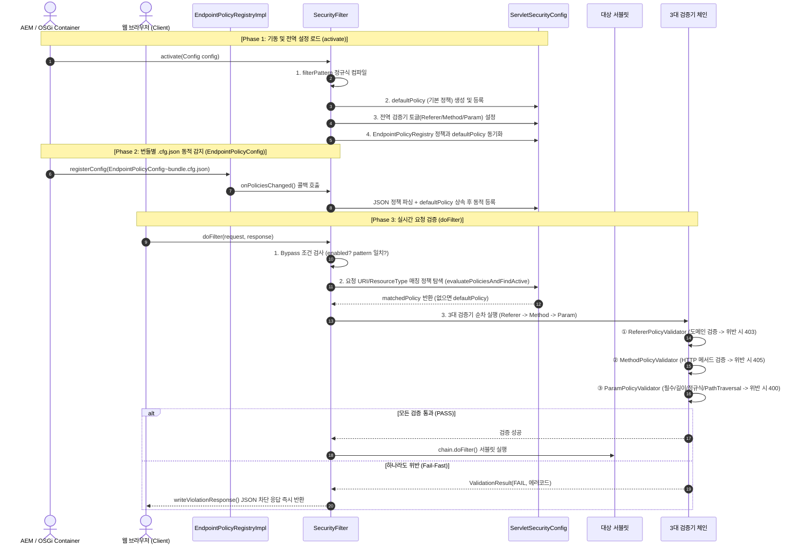
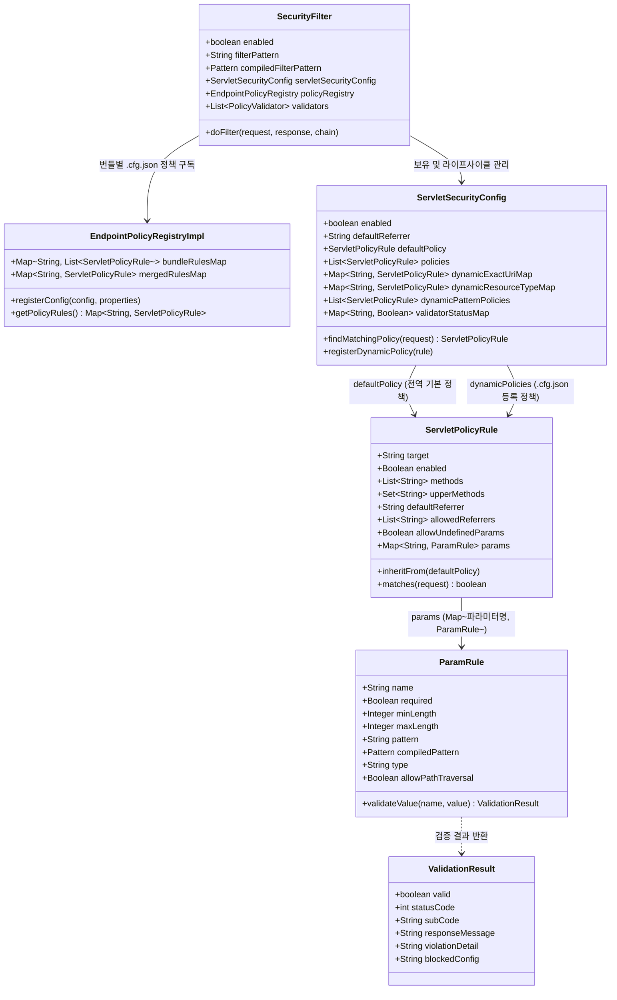

# 🛡️ AEM 6.5 Lightweight Security Filter (`security-simple`)

AEM 6.5 서블릿을 위한 **경량 보안 필터(`SecurityFilter`)** 프로젝트입니다.  
가장 핵심적인 **3대 보안 검증기(`RefererPolicyValidator`, `MethodPolicyValidator`, `ParamPolicyValidator`)**와 번들별 **`.cfg.json` 기반 정책 레지스트리(`EndpointPolicyRegistry`)** 구조로 가볍고 직관적으로 구성한 버전입니다.

---

## 📊 0. 아키텍처 및 기능 기술서 (PPT / 프레젠테이션 문서)

전체 시스템 아키텍처, 6단계 정책 매칭, 3대 Validator 동작 원리, DSL 문법, 로깅(`BlockedByConfig` / `AppliedServletPolicy`) 및 에러 코드 규격을 설명하는 프레젠테이션 문서가 [`docs/`](docs/) 디렉토리에 포함되어 있습니다:

- 📑 **PowerPoint 문서 (`.pptx`)**: [`docs/AEM_Security_Simple_Architecture_Guide.pptx`](docs/AEM_Security_Simple_Architecture_Guide.pptx) (총 19슬라이드, 16:9 와이드스크린 — 시스템 아키텍처 다이어그램[심플/상세], 필터 생명주기 및 처리 흐름도[Phase 1·2·3 시퀀스 다이어그램], UML 클래스 다이어그램[심플/상세] 포함)
- 🌐 **웹 슬라이드 덱 (`.html`)**: [`docs/AEM_Security_Simple_Presentation.html`](docs/AEM_Security_Simple_Presentation.html) (브라우저에서 바로 열람 및 방향키 `←`/`→` 이동, `Cmd+P` PDF 인쇄 지원)

---

## 📌 1. 핵심 3대 Validator 구성 및 실행 순서

필터 체인은 `sling.filter.pattern`(기본값: `(/aemapi/.*|/sysapi/.*)`)과 일치하는 요청에 대해 아래 3개 Validator를 순차 실행합니다:

| 순서 | Validator 클래스 | 검증기 코드명 | 주요 검증 내용 | 차단 시 응답 코드 |
| :---: | :--- | :---: | :--- | :---: |
| **1** | `RefererPolicyValidator` | `REFERER` | 요청 `Referer` 헤더가 기본 허용 도메인(`default.referrer`) 또는 정책의 `allowedReferrers`와 일치하는지 검증 | `403 Forbidden` (`SEC-40303`) |
| **2** | `MethodPolicyValidator` | `METHOD` | 요청 HTTP Method(`GET`, `POST` 등)가 허용된 `methods` 목록에 포함되는지 검증 | `405 Method Not Allowed` (`SEC-40501`) |
| **3** | `ParamPolicyValidator` | `PARAM` | 필수 여부(`required`), 미정의 파라미터 차단(`allowUndefinedParams=false`), Path Traversal(`SEC-40007`), 길이(`min..max`), 정규식(`pattern`) 검증 | `400 Bad Request` (`SEC-40001` ~ `SEC-40007`) |

---

## 🔄 2. 필터 생명주기 및 처리 흐름 (`activate` & `doFilter`)

`SecurityFilter`는 OSGi 컴포넌트로서 시스템 기동 및 설정 변경 시 실행되는 **`activate()` 단계**, 번들별 `.cfg.json` 설정을 수집하는 **`EndpointPolicyRegistry` 연동 단계**, 그리고 클라이언트의 HTTP 요청을 실시간으로 가로채 검증하는 **`doFilter()` 단계**로 나뉩니다.



### 2-1. 기동 및 설정 로드 관점 (`activate` & `EndpointPolicyRegistry`)
OSGi 프레임워크가 컴포넌트를 활성화(`@Activate`)하거나 설정 변경(`@Modified`) 시 호출합니다:
1. **필터 대상 패턴 사전 컴파일**: `config.sling_filter_pattern()`(기본값: `(/aemapi/.*|/sysapi/.*)`)을 `Pattern.compile()`로 메모리에 캐싱하여 런타임 정규식 컴파일 부하를 제거합니다.
2. **전역 기본 정책(`defaultPolicy`) 생성**: `config`의 `default.*` 속성을 바탕으로 베이스라인 `ServletPolicyRule`을 생성합니다 (기본 도메인 `abc.com`, 메서드 `GET, POST`, 공통 파라미터 `page, size, sort, keyword` 등).
3. **검증기 온/오프 토글 반영**: `config.validator_*_enabled()` 플래그를 읽어 필요 시 전역 수준에서 특정 검증기를 On/Off합니다.
4. **번들별 `.cfg.json` 레지스트리 동기화 (`syncRegistryPolicies`)**: `EndpointPolicyRegistry`에 로드된 번들별 `EndpointPolicyConfig~<번들명>.cfg.json` 정책들에 `defaultPolicy`를 상속시켜 `ServletSecurityConfig`에 동기화합니다.

### 2-2. 요청 가로채기 및 검증 관점 (`doFilter`)
클라이언트로부터 실제 HTTP 요청이 들어왔을 때 필터 체인에서 매번 실행됩니다:
1. **1차 필터링 및 건너뛰기 (Bypass)**:
   - 필터 전역 비활성(`enabled=false`), 비 HTTP 요청, 또는 URI가 `sling.filter.pattern`과 매칭되지 않는 경우 보안 검사를 수행하지 않고 즉시 `chain.doFilter`로 통과시킵니다.
2. **대상 정책 조회 및 판정 (`evaluatePoliciesAndFindActive`)**:
   - `servletSecurityConfig.findMatchingPolicy(request)`를 통해 URI 및 Sling ResourceType과 일치하는 서블릿 정책을 조회합니다. 개별 정책이 없으면 `defaultPolicy`가 적용됩니다.
   - 해당 정책이 비활성화(`enabled=false`)되어 있으면 보안 검사를 생략하고 통과합니다.
3. **3대 검증기 순차 실행 (Fail-Fast 체인)**:
   - **① `RefererPolicyValidator`**: 신뢰 도메인 확인 (`403 Forbidden` / `SEC-40301`)
   - **② `MethodPolicyValidator`**: 허용 HTTP Method 확인 (`405 Method Not Allowed` / `SEC-40501`)
   - **③ `ParamPolicyValidator`**: 필수값, 미정의 파라미터, 길이, 정규식, Path Traversal 검증 (`400 Bad Request` / `SEC-40001` ~ `SEC-40007`)
4. **결과 처리**:
   - **통과 시**: `chain.doFilter(request, response)`를 호출하여 대상 서블릿 비즈니스 로직을 정상 실행합니다.
   - **위반 시**: 서블릿 실행을 즉각 중단하고, `writeViolationResponse`를 통해 규격화된 에러 JSON과 HTTP 상태 코드를 클라이언트에 즉시 응답합니다.

---

## 🏛️ 3. 필터 핵심 데이터 구조 및 관계도 (Data Structures & Model)

필터는 객체 간 명확한 계층 분리와 런타임 O(1) 고속 조회를 위해 체계적인 데이터 모델 구조를 가집니다:



### 데이터 모델 계층 및 역할 명세

| 계층 / 모델 클래스 | 역할 및 보유 데이터 | 데이터 원천 (Source) | 핵심 특징 |
| :--- | :--- | :--- | :--- |
| **`SecurityFilter`**<br>(루트 필터) | • 필터 전체 활성화 여부(`enabled`)<br>• 필터 정규식(`sling.filter.pattern`)<br>• 정책 레지스트리 참조(`policyRegistry`)<br>• 3대 검증기 인스턴스 체인 | OSGi Configuration Admin<br>(`SecurityFilter.config`) | Sling REQUEST 필터로서 모든 인입 요청의 진입점 역할을 수행하며, `EndpointPolicyRegistry`의 변경 알림을 수신 |
| **`EndpointPolicyRegistry`**<br>(번들 정책 레지스트리) | • 번들별 정책 맵(`bundleRulesMap`)<br>• 병합된 타겟별 정책 맵(`mergedRulesMap`)<br>• 변경 콜백 리스너(`listeners`) | 번들별 `.cfg.json`<br>(`EndpointPolicyConfig~*.cfg.json`) | 각 번들의 `.cfg.json` 파일에 정의된 `policies` 배열을 파싱·수집하고 변경 시 `SecurityFilter`에 즉시 동기화 |
| **`ServletSecurityConfig`**<br>(전체 정책 컨테이너) | • 전역 기본 정책(`defaultPolicy`)<br>• 서블릿별 보안 정책 컬렉션(`policies`)<br>• O(1) 고속 매칭 인덱스(`dynamicExactUriMap`, `dynamicResourceTypeMap`)<br>• 검증기 On/Off 상태 맵 | `SecurityFilter.config` +<br>`EndpointPolicyRegistry` | 요청 인입 시 6단계 우선순위(URI 정확 일치 → ResourceType → 정규식 패턴 → DefaultPolicy)로 O(1) 고속 탐색 |
| **`ServletPolicyRule`**<br>(타겟별 보안 정책) | • 타겟 식별자(`target`: 경로 또는 resourceType)<br>• 허용 HTTP 메서드 화이트리스트(`methods`)<br>• 허용 Referer 목록(`allowedReferrers`)<br>• 미정의 파라미터 허용 여부(`allowUndefinedParams`)<br>• 파라미터 검증 맵(`params`) | 번들별 `.cfg.json` 내<br>`policies` 배열 항목 | `inheritFrom(defaultPolicy)`를 통해 선언되지 않은 기본값 및 공통 파라미터(`default.params`)를 자동 상속/병합 |
| **`ParamRule`**<br>(파라미터 검증 단위) | • 파라미터명(`name`)<br>• 필수 여부(`required`)<br>• 길이 제약(`minLength`, `maxLength`)<br>• 사전 컴파일된 정규식(`compiledPattern`)<br>• 타입 별칭(`digits`, `alnum`, `email` 등)<br>• 예외 플래그(`allowPathTraversal`) | `params` DSL 배열 | 인입 파라미터의 값 하나하나에 대해 타입, 길이, 정규식, PathTraversal 공격 구문을 정밀 검증 |
| **`ValidationResult`**<br>(검증 결과 DTO) | • 검증 성공 여부(`valid`)<br>• HTTP 응답 상태 코드(`400`, `403`, `405`)<br>• 표준 에러 서브코드(`SEC-40001` ~ `SEC-40501`)<br>• 에러 메시지 및 상세 차단 원인(`BlockedByConfig`) | 각 `PolicyValidator` 검증 실행 시 반환 | 검증 실패 시 상위 필터로 차단 사유를 전달하여 즉각적인 Fail-Fast JSON 응답 생성 |

---

### 데이터 상속 및 병합 (Inheritance & Merge) 구조

번들별 `.cfg.json` 정책이 `EndpointPolicyRegistry`를 통해 로드될 때, **기본 정책(`defaultPolicy`)과 서블릿 개별 정책(`rule`)의 데이터는 다음과 같이 합성(Merge)**됩니다:

```text
[OSGi 전역 설정: SecurityFilter.config]
  └─ defaultPolicy (ServletPolicyRule)
       ├─ methods = [GET, POST]
       ├─ defaultReferrer = "abc.com"
       ├─ allowUndefinedParams = false
       └─ params = {page: ParamRule, size: ParamRule, sort: ParamRule, ...}
            │
            │  inheritFrom(defaultPolicy) 자동 상속
            ▼
[번들별 .cfg.json: EndpointPolicyConfig~core-member.cfg.json]
  └─ 서블릿 정책 (ServletPolicyRule: target="/aemapi/user/contact")
       ├─ methods = [POST]                   <-- .cfg.json 설정으로 재정의 (Override)
       ├─ defaultReferrer = "abc.com"        <-- defaultPolicy 값 상속
       ├─ allowUndefinedParams = false       <-- defaultPolicy 값 상속
       └─ params = {
            page: ParamRule, size: ParamRule <-- defaultPolicy의 기본 파라미터 자동 상속!
            name: ParamRule, email: ...      <-- 서블릿 전용 파라미터 규칙 추가/병합!
          }
```

---

## ⚙️ 4. 전역 OSGi 설정 (`config/com.example.security.filters.SecurityFilter.config`)

```ini
enabled=B"true"
sling.filter.pattern="(/aemapi/.*|/sysapi/.*)"

validator.referer.enabled=B"true"
validator.method.enabled=B"true"
validator.param.enabled=B"true"

default.enabled=B"true"
default.referrer="abc.com"
default.methods=["GET","POST"]
default.allowUndefinedParams=B"false"
default.params=[ \
  "page:optional:digits:5", \
  "size:optional:digits:4", \
  "sort:optional:alnum:30", \
  "order:optional:asc|desc:4", \
  "lang:optional:pattern(^[a-zA-Z]{2}(?:-[a-zA-Z0-9]{2,})?$):10", \
  "keyword:optional:100" \
]
# 번들별 .cfg.json 정책을 무시하고 글로벌 defaultPolicy만 강제 적용할지 여부 (기본값: false)
default.ignoreServletPolicies=B"false"
```

---

## 🧩 5. 번들별 `.cfg.json` (`EndpointPolicyConfig`) 및 파라미터(`params`) 설정 가이드

서블릿 클래스(`@Component`)에는 순수 Sling 라우팅 프로퍼티(`sling.servlet.paths`, `sling.servlet.methods` 등)만 선언하고, 모든 보안 정책은 `config/com.example.security.registry.EndpointPolicyConfig~<번들명>.cfg.json` 파일의 `policies` 배열에서 관리합니다.  
`params` 배열 안에서는 콜론(`:`) 구분자 기반의 간편 DSL 문법(`"파라미터명:필수여부:타입또는패턴:길이"`)으로 검증 규칙을 선언합니다. 토큰 순서는 첫 번째 `파라미터명`만 고정이며, 나머지 토큰(`required`, `타입`, `길이`)은 순서에 관계없이 자유롭게 조합할 수 있습니다.

---

### Case 1. 번들별 `.cfg.json` 기본 구조 (`EndpointPolicyConfig~<번들명>.cfg.json`)

하나의 `.cfg.json` 파일 안에 여러 서블릿 경로(`target`)의 정책 객체를 배열(`policies`) 형태로 선언합니다:

```json
{
  "enabled": true,
  "bundle.id": "core-member",
  "policies": [
    {
      "target": "/aemapi/user/contact",
      "methods": ["POST"],
      "allowedReferrers": ["partner.abc.com"],
      "allowUndefinedParams": false,
      "params": [
        "name:required:korean:2..20",
        "email:required:email:50",
        "phone:optional:phone",
        "category:required:inquiry|bug|feedback|other:15",
        "message:required:10..500",
        "attachmentPath:optional:200:allowPathTraversal"
      ]
    },
    {
      "target": "/aemapi/user/profile",
      "methods": ["GET"],
      "params": [
        "memberId:required:alnum:4..20"
      ]
    }
  ]
}
```

---

### Case 2. 글자 수 / 길이 제한 (`minLength`, `maxLength`) 설정 케이스

| 세부 케이스 | `.cfg.json` 내 `params` 항목 예시 | 동작 설명 (`ParamRule`) | 위반 시 에러 코드 |
| :--- | :--- | :--- | :---: |
| **① 최소~최대 길이 동시 지정 (`min..max`)** | `"userId:required:alnum:4..20"` | 4자 이상 ~ 20자 이하 (`minLength=4, maxLength=20`) | 4자 미만: `SEC-40003`<br>20자 초과: `SEC-40004` |
| **② 최대 길이만 지정 (`숫자` 또는 `max:숫자`)** | `"title:required:50"`<br>`"title:required:max:50"` | 최소 길이 제한 없음, 최대 50자 이하 (`minLength=null, maxLength=50`) | 50자 초과: `SEC-40004` |
| **③ 최소 길이만 지정 (`min:숫자`)** | `"feedback:required:min:10"` | 최소 10자 이상, 최대 길이 제한 없음 (`minLength=10, maxLength=null`) | 10자 미만: `SEC-40003` |
| **④ 패턴 없이 길이만 제한 (자유 텍스트)** | `"message:required:10..500"`<br>`"keyword:optional:100"` | 정규식(`pattern`) 없이 글자 수만 제한 (단, PathTraversal은 기본 차단됨) | `SEC-40003` / `SEC-40004` |
| **⑤ 길이 지정 생략 (`min/maxLength` 미지정)** | `"deptCode:required:alpha"` | `minLength=null, maxLength=null`로 길이 검사를 생략하고 영문자 정규식만 검사 | 형식 불일치: `SEC-40005` |

---

### Case 3. 내장 타입 별칭(Type Alias) 활용 케이스

정규식을 직접 작성하지 않고 내장 키워드만 적어도 자동으로 검증 정규식이 적용됩니다. 규격 길이가 정해진 일부 타입(`email`, `phone`, `date` 등)은 길이를 생략해도 기본 `maxLength`가 자동 적용되며, 별도 길이를 적으면 적은 값이 우선합니다.

```json
{
  "target": "/aemapi/member/register",
  "methods": ["POST"],
  "params": [
    "age:optional:digits:3",
    "memberId:required:alnum:4..20",
    "countryCode:optional:alpha:2",
    "userName:required:korean:2..20",
    "email:required:email:50",
    "mobile:required:phone",
    "birthDate:optional:date",
    "reservedAt:optional:datetime",
    "requestId:optional:uuid",
    "zip:optional:zipcode",
    "clientIp:optional:ip",
    "homepage:optional:url:200"
  ]
}
```

| 내장 타입 키워드 | 자동 변환되는 정규식 (`pattern`) | 길이 생략 시 기본 `maxLength` |
| :--- | :--- | :---: |
| `digits` / `number` / `numeric` | `^[0-9]+$` | `null` (제한 없음) |
| `alnum` / `alphanumeric` | `^[a-zA-Z0-9_]+$` | `null` (제한 없음) |
| `alpha` | `^[a-zA-Z]+$` | `null` (제한 없음) |
| `korean` / `hangul` | `^[가-힣a-zA-Z\s]+$` | `null` (제한 없음) |
| `email` | `^[a-zA-Z0-9._%+-]+@[a-zA-Z0-9.-]+\.[a-zA-Z]{2,}$` | `100` |
| `phone` | `^01[016789]-?\d{3,4}-?\d{4}$` | `13` |
| `date` | `^\d{4}-\d{2}-\d{2}$` | `10` |
| `datetime` | `^\d{4}-\d{2}-\d{2}[ T]\d{2}:\d{2}(?::\d{2})?$` | `19` |
| `time` | `^\d{2}:\d{2}(?::\d{2})?$` | `8` |
| `uuid` | `^[0-9a-fA-F]{8}-[0-9a-fA-F]{4}-[0-9a-fA-F]{4}-[0-9a-fA-F]{4}-[0-9a-fA-F]{12}$` | `36` |
| `zipcode` / `postal` | `^\d{5}$` | `5` |
| `ip` / `ipv4` | IPv4 주소 정규식 | `15` |
| `url` | `^https?://[a-zA-Z0-9.-]+(?:\.[a-zA-Z]{2,})+(?:/[^\s<>"]*)?$` | `null` (제한 없음) |

---

### Case 4. 허용값 목록(Enum) 및 커스텀 정규식(`pattern(...)`) 케이스

정해진 코드값만 허용하거나 프로젝트 고유의 포맷(주문번호, 쿠폰코드 등)을 정규식으로 검증할 때 사용합니다.  
정규식 내부에 콜론(`:`)이나 괄호(`(?:...)`)가 포함되어 있어도 `splitPreservingParens` 파서가 괄호 깊이를 계산하여 안전하게 파싱합니다.

```json
{
  "target": "/aemapi/coupon/issue",
  "methods": ["POST"],
  "params": [
    "grade:required:VIP|GOLD|SILVER:10",
    "sortOrder:optional:asc|desc:4",
    "couponCode:required:pattern(^CPN-[A-Z0-9]{4}-[A-Z0-9]{4}$):15",
    "locale:optional:pattern(^[a-z]{2}(?:-[A-Z]{2})?$):5"
  ]
}
```

---

### Case 5. 미정의 파라미터 허용(`allowUndefinedParams`) 및 기본 정책(`default.params`) 상속 케이스

1. **기본 정책(`default.params`) 자동 상속**:
   - `.cfg.json`의 `params`에 `page`, `size`, `sort`, `order`, `lang`, `keyword`를 따로 적지 않아도 `SecurityFilter.config`의 `default.params`가 자동 상속되므로 페이징·정렬 파라미터를 바로 사용할 수 있습니다.
   - 만약 특정 정책에서 `"keyword:required:2..50"`을 선언하면 기본 정책의 `keyword:optional:100` 대신 **해당 정책에 선언한 규칙이 우선 적용(Override)**됩니다.
2. **정의되지 않은 파라미터 허용 (`"allowUndefinedParams": true`)**:
   - 기본값은 `false`(화이트리스트에 없는 파라미터가 1개라도 들어오면 `SEC-40002` 차단)입니다.
   - 외부 웹훅 수신이나 가변 파라미터를 받는 엔드포인트의 경우 `"allowUndefinedParams": true`로 설정하면 미정의 파라미터도 허용하되, **유입되는 모든 미정의 파라미터 값에 대해서도 Path Traversal 검사는 자동으로 수행**하여 안전하게 보호합니다:
   ```json
   {
     "target": "/aemapi/webhook/callback",
     "methods": ["POST"],
     "allowUndefinedParams": true,
     "params": [
       "signature:required:64"
     ]
   }
   ```

---

## 🚨 6. 차단 시 로그 출력 예시 (`BlockedByConfig` & `AppliedServletPolicy`)

요청이 필터에 의해 차단되면 **어떤 설정 규칙과 입력값 때문에 막혔는지(`BlockedByConfig`)**와 **해당 서블릿에 적용된 전체 보안 설정(`AppliedServletPolicy`)**이 동시에 출력됩니다:

```text
SECURITY VIOLATION BLOCKED: Client IP=[127.0.0.1], Method=[POST], URI=[/aemapi/user/contact], Validator=[PARAM], Status=[400], ErrorCode=[SEC-40003], Reason=[Parameter [name] length (1) < min (2)]
  | BlockedByConfig=[param=name, minLength=2, actualLength=1, rule={required=true, len=2..20, pattern='^[가-힣a-zA-Z\s]+$'}]
  | AppliedServletPolicy=[source=EndpointPolicyConfig~core-member, target=/aemapi/user/contact, methods=[POST], allowedReferrers=[abc.com, partner.abc.com], allowUndefinedParams=false, params={page={required=false, len=0..5, pattern='^[0-9]+$'}, ..., name={required=true, len=2..20, pattern='^[가-힣a-zA-Z\s]+$'}, email={required=true, len=0..50, pattern='^[a-zA-Z0-9._%+-]+@[a-zA-Z0-9.-]+\.[a-zA-Z]{2,}$'}}]
```
